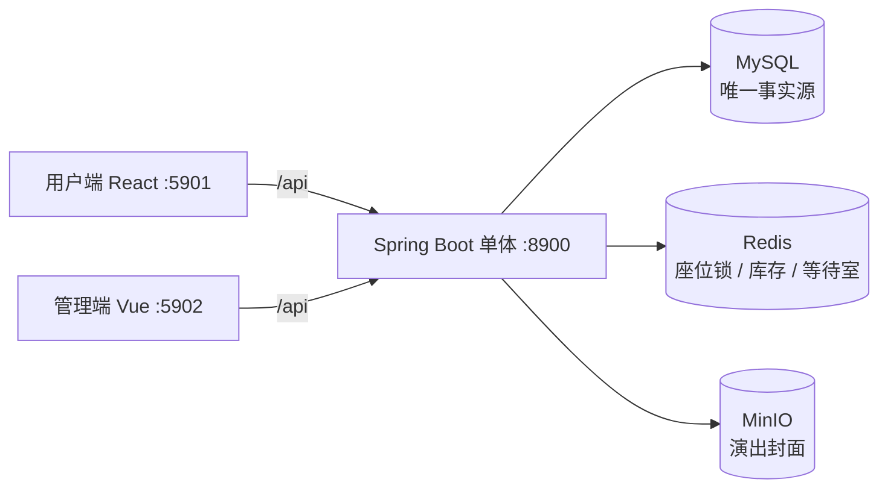

# TicketBox


自营式演出票务平台：面向购票用户与运营方的单体应用，重点解决热点场次并发下的库存与订单一致性。

单体 Spring Boot + MySQL + Redis + MinIO，React 用户端与 Vue 管理端。

## 核心能力

- **用户端**：按城市浏览演出、查看场次、有座选座或无座购票、等待室排队、mock 支付、查看电子票二维码。
- **管理端**：发布演出、创建场次、配置票档与区域座位、开关等待室、查询订单、扫码核销。
- **并发正确性**：座位锁、无座库存、限购计数、订单幂等与超时回收都有对应的数据库约束或条件更新兜底。
- **可验证的架构**：按 feature 分包，包内 `web/domain` 两段，依赖方向由 ArchUnit 测试固化。

## 技术亮点

- **防超卖的三重防线**：Redis `SET NX` 预锁座位 → MySQL 条件扣减库存 → `ticket(performance_id, seat_id)` 唯一约束作为最终防线。Redis 丢失后可从数据库重建，不会导致超卖。
- **热点场次等待室**：按开票时间与放行速率计算准入位次，获放行者获得 TTL 令牌；选座与下单接口校验令牌，未启用等待室的场次直连。
- **幂等与超时释放**：`Idempotency-Key` 用户级唯一约束加 Redis 互斥，重复请求返回同一订单；15 分钟未支付由定时任务取消，座位、库存、限购与支付单走同一条释放路径。
- **支付与核销**：mock 网关通过真实 HTTP 回调通知，HMAC 验签且回调幂等；电子票二维码同样 HMAC 签名，核销为一次性条件更新。

## 架构



MySQL 是唯一事实源；Redis 只承担选座锁、库存预扣与等待室准入，全部可从数据库重建。

## 技术栈

| 层 | 选型 |
| --- | --- |
| 后端 | Java 21、Spring Boot 4.1、Spring MVC / Security / Data JPA、Flyway |
| 数据 | MySQL 8、Redis 7、MinIO |
| 用户端 | React 19、TypeScript、Vite、Tailwind CSS、shadcn/ui |
| 管理端 | Vue 3、TypeScript、Vite、Element Plus |
| 测试 | JUnit 5、Testcontainers（MySQL / Redis / MinIO）、ArchUnit |

## 快速开始

需要 JDK 21、Maven、Node.js 22+、pnpm 与 Docker。

```bash
# 基础设施（MySQL 3306、Redis 6379、MinIO 9000/9001）
docker compose -f ops/docker-compose.yml up -d mysql redis minio

# 后端（:8900，dev profile 会创建管理员与演示演出）
SPRING_PROFILES_ACTIVE=dev mvn spring-boot:run

# 用户端（:5901）
cd frontend/web && pnpm install && pnpm dev

# 管理端（:5902）
cd frontend/admin && pnpm install && pnpm dev
```

- 用户端：<http://localhost:5901>，自行注册后即可购票。
- 管理端：<http://localhost:5902>，dev profile 账号 `admin` / `ticketadmin`。
- dev profile 会种一个已发布演出及场次；`admin/ticketadmin` 仅用于本地开发，正式部署必须替换全部密钥。

## 测试

```bash
mvn test
```

73 个测试，全部跑在真实依赖上：Testcontainers 启动 MySQL、Redis 与 MinIO，不使用 H2 或 mock 仓储。覆盖注册登录、演出与场次、座位图、有座/无座下单、幂等、取消与超时、支付回调、核销与等待室；另有 3 条 ArchUnit 规则验证包依赖方向。

## 构建与部署

```bash
# 构建两端并复制进 Spring 静态资源
./ops/build-frontends.sh

# 打包
mvn -DskipTests package

# 运行（dev profile 注入开发默认密钥）
SPRING_PROFILES_ACTIVE=dev java -jar target/ticketbox-*.jar
```

用户端挂 `/`，管理端挂 `/admin/`，均由 Spring 托管。

也可以整体容器化：

```bash
docker compose -f ops/docker-compose.yml up --build
```

正式部署时设置 `SPRING_PROFILES_ACTIVE` 为空，并注入 `JWT_SECRET`、`PAYMENT_CALLBACK_SECRET`、`TICKET_QR_SECRET`、`MINIO_ENDPOINT`、`MINIO_ACCESS_KEY`、`MINIO_SECRET_KEY` 等环境变量。

## 项目结构

```
src/main/java/com/cdwater/ticketbox
├── auth/ event/ performance/ seat/ order/ payment/ ticket/ waitingroom/ storage/
│   ├── web/     # Controller，以及只被 Controller 使用的映射器
│   └── domain/  # 实体、仓储、服务、入站 command 与响应读模型
├── common/      # 异常、分页、HMAC；web/ 为 HTTP 公共组件
└── dev/         # dev profile 种子数据
```

feature 之间只允许依赖对方的 `domain`，`web` 不被其他代码引用；取舍与原因见 [ADR 0003](docs/adr/0003-feature-package-layout.md)。

## 文档

- [设计文档](docs/design.md)：数据模型、并发与库存、API、部署
- [术语表](GLOSSARY.md)
- [架构决策记录](docs/adr/)

## License

[MIT](LICENSE)
